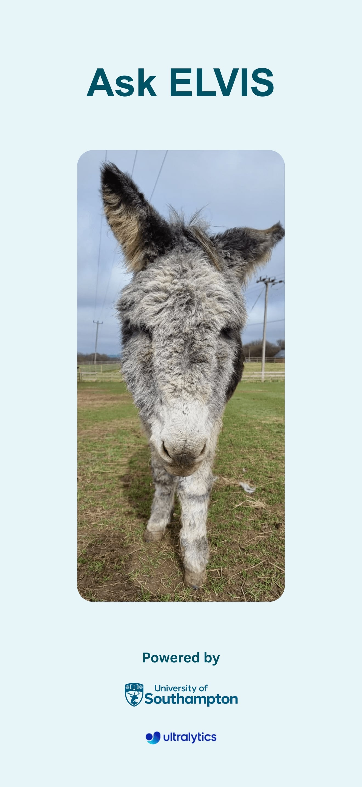
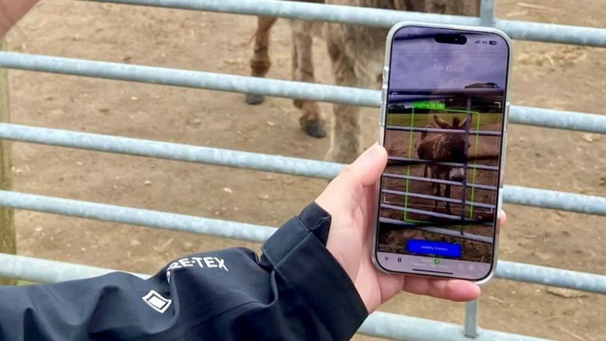

# Ask ELVIS — Donkey Identification iOS App

<p align="center"></p>

Ask ELVIS is an iOS app that identifies individual donkeys by name from the phone camera. It was developed at the University of Southampton with the Isle of Wight Donkey Sanctuary, so that staff and visitors can point a phone at a donkey and see who it is.

The app is built on top of the [Ultralytics YOLO iOS app](https://github.com/ultralytics/yolo-ios-app) and adds a re-identification stage on top of YOLO detection.

<p align="center"><br>
<em>Ask ELVIS in use at the sanctuary. Photo: Isle of Wight Donkey Sanctuary / University of Southampton, via <a href="https://www.bbc.com/news/articles/cgrxjd1l2p1o">BBC News</a></em></p>

## How it works

```
Camera frame
  └─ YOLO detector (best.mlpackage, CoreML)        → finds the donkey bounding box (confidence > 0.4)
       └─ crop + resize to 224×224
            └─ MegaDescriptor (MegaDescriptor.mlpackage) → 768-dim feature vector
                 └─ compare against reference gallery   → top-3 names with scores
                    (features_and_labels.json)
```

1. **Detection** — a custom YOLO model (`Models/best.mlpackage`) runs on every camera frame through Vision (`VNCoreMLRequest`). Boxes that cover more than 80% of the frame are discarded as false detections.
2. **Feature extraction** — when the user taps *Identify*, the detected box is cropped, resized to 224×224 and passed to `Models/MegaDescriptor.mlpackage`, which outputs a 768-dimensional embedding.
3. **Matching** — the embedding is compared with every reference embedding in `Models/features_and_labels.json` (1,620 reference images covering 115 labels). The similarity score combines cosine similarity, Euclidean distance and Manhattan distance on L2-normalised vectors. Matches are grouped by donkey name and ranked by a weighted mix of the best, mean and worst score; the top 3 are shown.
4. **Result** — the top name is shown on screen, and the user can open that donkey's page on the sanctuary website or save the annotated photo to the photo library.

## Repository contents

| Path | Description |
|---|---|
| `ViewController.swift` | Main screen: camera preview, detection, identification, matching and UI |
| `VideoCapture.swift` | AVFoundation camera capture |
| `AppDelegate.swift` | App entry point |
| `Utilities/BoundingBoxView.swift` | Draws detection boxes and labels |
| `Utilities/ThresholdProvider.swift` | IoU / confidence thresholds for the Vision request |
| `Models/best.mlpackage` | Donkey detector (YOLO, CoreML) |
| `Models/MegaDescriptor.mlpackage` | Feature extractor for re-identification (CoreML) |
| `Models/features_and_labels.json` | Reference gallery: 1,620 embeddings with image labels (`Name_00000.jpg`) |
| `Main.storyboard`, `LaunchScreen.storyboard`, `Assets.xcassets`, `Settings.bundle`, `Info.plist` | UI and app resources |

> The Xcode project file (`.xcodeproj`) is not included in this repository. The source files are meant to replace the corresponding files in the Ultralytics YOLO iOS app project.

## Build

Requirements: a Mac with Xcode, an iPhone (camera required — the simulator cannot run the camera pipeline) and an Apple Developer account for signing.

1. Clone the Ultralytics base project and this repository:
   ```bash
   git clone https://github.com/ultralytics/yolo-ios-app.git
   git clone https://github.com/YCL-Jeff/Ask-Elvis.git
   ```
2. Open the Ultralytics project in Xcode and replace its app source files, storyboards and assets with the files from this repository.
3. Add `Models/best.mlpackage`, `Models/MegaDescriptor.mlpackage` and `Models/features_and_labels.json` to the app target (*Copy Bundle Resources*). The app looks them up by these names at launch.
4. Select your team under *Signing & Capabilities*, connect the iPhone and run.

## Updating the reference gallery

`features_and_labels.json` has the format:

```json
{ "features": [[768 floats], ...], "labels": ["Amber_00000.jpg", ...] }
```

The donkey name is taken from the label text before the last `_`. To add a donkey, generate MegaDescriptor embeddings for its photos with the same 224×224 preprocessing and append them with labels in the same format.

## In the news

- University of Southampton — [AI to be used for donkey identification](https://www.southampton.ac.uk/news/2025/06/ai-to-be-used-for-donkey-identification.page) (17 June 2025)
- ITV News — [Artificial intelligence tech developed for donkey sanctuary](https://www.itv.com/watch/news/artificial-intelligence-tech-developed-for-donkey-sanctuary/86rw4h6) (16 June 2025)
- OnTheWight — [Ask ELVIS: New AI app to help visitors connect with donkeys at sanctuary](https://onthewight.com/ask-elvis-new-ai-app-to-help-visitors-connect-with-donkeys-at-sanctuary/)
- BBC News — [AI to help tell donkeys apart at island sanctuary](https://www.bbc.com/news/articles/cgrxjd1l2p1o) (18 June 2025)

## Related repositories

- [Ask-Elvis_Flutter](https://github.com/YCL-Jeff/Ask-Elvis_Flutter) — cross-platform Flutter prototype of the app UI

## Licence

This app is derived from the Ultralytics YOLO iOS app, which is licensed under [AGPL-3.0](https://github.com/ultralytics/yolo-ios-app/blob/main/LICENSE). Donkey photos and names belong to the Isle of Wight Donkey Sanctuary.

## Author

Yu-Cheng Lai ([YCL-Jeff](https://github.com/YCL-Jeff)), University of Southampton
